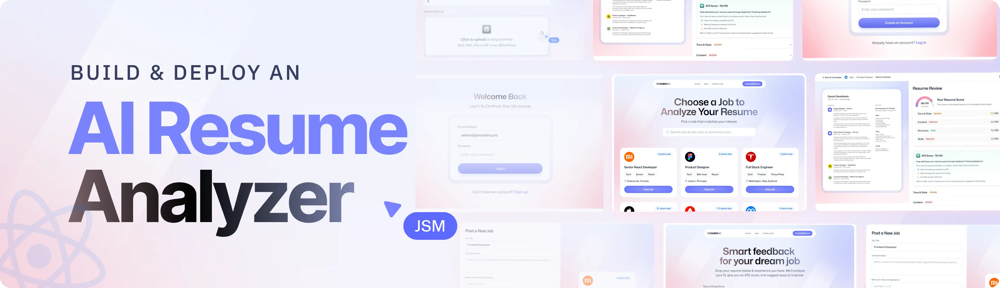

<div align="center">
  <br />
  
    </a>
  <br />

  <div>
    
        
        
  </div>

  <h3 align="center">AI Resume Analyzer</h3>

   <div align="center">
    </div>
</div>

## 📋 <a name="table">Table of Contents</a>

1. ✨ [Introduction](#introduction)
2. ⚙️ [Tech Stack](#tech-stack)
3. 🔋 [Features](#features)
4. 🤸 [Quick Start](#quick-start)
5. 🔗 [Assets](#links)
6. 🚀 [More](#more)

## <a name="introduction">✨ Introduction</a>

Build an AI-powered **ATS Resume Checker** with React, React Router v7, and Tailwind CSS! Upload your resume, paste a job description, and get instant AI-powered feedback with ATS scores, keyword gaps, and actionable improvements — **completely free, no login required, and your data never leaves your browser.**


## <a name="tech-stack">⚙️ Tech Stack</a>

- **[React 19](https://react.dev/)** — Modern React with concurrent features and Server Components support
- **[React Router v7](https://reactrouter.com/)** — File-based routing, data loaders/actions, SSR, and type-safe routes
- **[Tailwind CSS v4](https://tailwindcss.com/)** — Utility-first CSS with CSS-variable theming and zero-config setup
- **[TypeScript](https://www.typescriptlang.org/)** — Strict type safety across the entire codebase
- **[Vite 6](https://vite.dev/)** — Lightning-fast dev server and optimized production builds
- **[Zustand](https://github.com/pmndrs/zustand)** — Minimal, hook-based global state (used for UI state only)
- **[pdfjs-dist](https://github.com/mozilla/pdf.js)** — Client-side PDF parsing and preview generation
- **[react-dropzone](https://react-dropzone.js.org/)** — Accessible drag-and-drop file uploads

**No backend, no database, no auth provider** — everything runs client-side via `localStorage`.

## <a name="features">🔋 Features</a>

👉 **Zero-auth flow**: Visit → Upload → Analyze → Results — no accounts, no redirects, no friction

👉 **Privacy-first**: Your resume never leaves your browser; all storage is local `localStorage`

👉 **AI resume matching** (mock): Paste a job description, get an ATS score with section-by-section feedback

👉 **PDF upload & preview**: Drag-and-drop PDF, instant first-page preview, secure local processing

👉 **Detailed scoring**: Overall + ATS + Tone & Style + Content + Structure + Skills breakdowns

👉 **Actionable tips**: Every score comes with specific, prioritized improvements and explanations

👉 **Persistent across sessions**: Data survives browser restarts; `/wipe` page to clear everything

👉 **Modern, accessible UI**: Tailwind v4, semantic HTML, ARIA labels, keyboard navigation, reduced-motion support

👉 **Responsive design**: Works beautifully on mobile, tablet, and desktop

## <a name="quick-start">🤸 Quick Start</a>

Follow these steps to set up the project locally on your machine.

**Prerequisites**

Make sure you have the following installed on your machine:

- [Git](https://git-scm.com/)
- [Node.js](https://nodejs.org/en)
- [npm](https://www.npmjs.com/) (Node Package Manager)

**Cloning the Repository**

```bash
git clone https://github.com/adrianhajdin/ai-resume-analyzer.git
cd ai-resume-analyzer
```

**Installation**

Install the project dependencies using npm:

```bash
npm install
```

**Running the Project**

```bash
npm run dev
```

Open [http://localhost:5173](http://localhost:5173) in your browser to view the project.

Enjoyed creating this project? Dive deeper into our PRO courses for a richer learning adventure. They're packed with
detailed explanations, cool features, and exercises to boost your skills. Give it a go!


